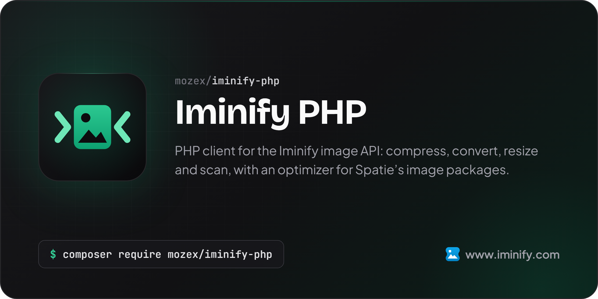

[](https://www.iminify.com/docs/php)

# Iminify PHP

[](https://packagist.org/packages/mozex/iminify-php)
[](https://github.com/mozex/iminify-php/actions/workflows/checks.yml)
[](https://www.iminify.com/docs/php)
[](https://packagist.org/packages/mozex/iminify-php)
[](https://packagist.org/packages/mozex/iminify-php)

The PHP client for the [Iminify](https://www.iminify.com) image optimization API. Send an image, wait for it and save the smaller file in a few lines, and reach the rest of the API too: upload groups, page scans, site crawls, weekly checks, your account and webhook signatures. It also has an optimizer for Spatie's image packages, so a chain, `spatie/image` or Browsershot can compress through Iminify with no binaries on the server.

> **[Read the full documentation at www.iminify.com](https://www.iminify.com/docs/php)**: every guide and reference page, updated with each release.

> **Using Laravel?** [Iminify Laravel](https://www.iminify.com/docs/laravel) puts this client in your app's container behind an `Iminify` facade, and plugs Iminify into Spatie's Media Library and laravel-image-optimizer.

## Table of Contents

- [Introduction](https://www.iminify.com/docs/php)
- Usage
  - [Images](https://www.iminify.com/docs/php/usage/images)
  - [Upload Groups](https://www.iminify.com/docs/php/usage/upload-groups)
  - [Page Scans](https://www.iminify.com/docs/php/usage/page-scans)
  - [Site Crawls](https://www.iminify.com/docs/php/usage/site-crawls)
  - [Weekly Checks](https://www.iminify.com/docs/php/usage/weekly-checks)
  - [Account](https://www.iminify.com/docs/php/usage/account)
  - [Webhooks](https://www.iminify.com/docs/php/usage/webhooks)
- Integrations
  - [Spatie's Image Packages](https://www.iminify.com/docs/php/integrations/spatie)
  - [AI Coding Assistants](https://www.iminify.com/docs/php/integrations/ai-assistants)
- Reference
  - [Configuration](https://www.iminify.com/docs/php/reference/configuration)
  - [Error Handling](https://www.iminify.com/docs/php/reference/error-handling)
  - [Testing](https://www.iminify.com/docs/php/reference/testing)

## Support This Project

I maintain this package along with [several other open-source PHP packages](https://mozex.dev/docs) used by thousands of developers every day.

If my packages save you time or help your business, consider [**sponsoring my work on GitHub Sponsors**](https://github.com/sponsors/mozex). Your support lets me keep these packages updated, respond to issues quickly, and ship new features.

Business sponsors get logo placement in package READMEs. [**See sponsorship tiers →**](https://github.com/sponsors/mozex)

## What You Get

The API works in the background, so every long-running record has a `wait()` that backs off between reads, waits out a short rate limit and stops at the timeout you give it.

A refusal throws its own exception: `DailyLimitReachedException` for a spent daily allowance, `RateLimitedException` with its `$retryAfter` for a short limit, `ValidationException` with its `$errors` for a bad field, and [the rest](https://www.iminify.com/docs/php/reference/error-handling).

`IminifyOptimizer` takes jpegoptim's place in a [Spatie chain](https://www.iminify.com/docs/php/integrations/spatie), so the server needs no binaries, and a failure leaves the file exactly as it was. For your own tests, [`FakeClient`](https://www.iminify.com/docs/php/reference/testing) answers from a queue through the real resources, so your code reads the same objects and catches the same exceptions as it does for real.

It's built on PSR-18, so it uses Guzzle, Symfony's client or whatever your project already has.

## Installation

> **Requires [PHP 8.2+](https://php.net/releases/)** - see [all version requirements](https://packagist.org/packages/mozex/iminify-php)

```bash
composer require mozex/iminify-php
```

The client needs a PSR-18 HTTP client and PSR-17 factories, and finds what your project has. A project with neither needs one, such as `composer require guzzlehttp/guzzle`. You also need an API key from Settings, API Tokens on [www.iminify.com](https://www.iminify.com).

## Quick Start

Send an image, wait for it and save the result:

```php
use Mozex\Iminify\Iminify;

$client = Iminify::factory()
    ->withApiKey(getenv('IMINIFY_API_KEY'))
    ->withTimeout(300)
    ->make();

$image = $client->images()->upload('photos/team.jpg', ['format' => 'webp']);
$image = $client->images()->wait($image);

if ($image->hasResult()) {
    $client->images()->download($image)->saveTo('photos/team.webp');
}

echo "{$image->status->value}, saved {$image->savedPercent}%";
```

Give the client a timeout: PSR-18 has none of its own, and `wait()` only checks its clock between reads, so a stalled read otherwise blocks forever. It covers a whole request, an upload or a download included, so set it with your largest file in mind.

### Handling a refusal

```php
use Mozex\Iminify\Exceptions\DailyLimitReachedException;
use Mozex\Iminify\Exceptions\RateLimitedException;

try {
    $image = $client->images()->upload('photos/team.jpg');
} catch (RateLimitedException $exception) {
    sleep($exception->retryAfter ?? 5);
    $image = $client->images()->upload('photos/team.jpg');
} catch (DailyLimitReachedException) {
    // Out for today
}
```

### Upload groups

One image and every size and format you keep of it, counted as one image:

```php
use Mozex\Iminify\Enums\GroupFormat;
use Mozex\Iminify\Http\Upload;

$upload = Upload::fromPath('photos/team.jpg');

$group = $client->groups()->create([
    'source' => ['format' => 'jpg', 'size' => $upload->size(), 'width' => 2560, 'height' => 1707],
    'outputs' => [
        ['name' => 'full', 'width' => 2560, 'height' => 1707],
        ['name' => 'medium', 'width' => 300, 'height' => 200],
    ],
    'formats' => [GroupFormat::Original, GroupFormat::Webp],
]);

$group = $client->groups()->sendSource($group, $upload);
$group = $client->groups()->wait($group);

$client->groups()->download($group)->saveTo('photos/team.zip');
```

The `width` and `height` are yours to work out, because the API wants them as displayed and `getimagesize()` gives them as stored.

### Spatie's image optimizer

```php
use Mozex\Iminify\Spatie\IminifyOptimizer;
use Spatie\ImageOptimizer\OptimizerChain;

$chain = (new OptimizerChain)->addOptimizer(new IminifyOptimizer([
    'api_key' => getenv('IMINIFY_API_KEY'),
]));

$chain->optimize('photos/team.jpg');
```

Build the chain this way rather than through `OptimizerChainFactory::create()`, which silently ignores a list holding only this optimizer.

### Your own tests

```php
use Mozex\Iminify\Testing\FakeClient;
use Mozex\Iminify\Testing\Fixtures;

$client = new FakeClient([Fixtures::image()]);

$image = $client->images()->get('abc');

$client->assertSent('GET', 'images/abc');
```

### Webhooks

```php
use Mozex\Iminify\Webhooks\WebhookVerifier;

$event = (new WebhookVerifier($secret))->verify($rawBody, $signatureHeader);
```

That's the common path. Scans, crawls, weekly checks and every option are in the [documentation](https://www.iminify.com/docs/php).

## Resources

Visit the [documentation at www.iminify.com](https://www.iminify.com/docs/php) for every guide and reference page, updated from this repository with each release.

- **[Requirements](https://packagist.org/packages/mozex/iminify-php)**: PHP and dependency versions
- **[Changelog](https://github.com/mozex/iminify-php/blob/main/CHANGELOG.md)**: Release history with linked pull requests and diffs
- **[Questions & Issues](https://github.com/mozex/iminify-php/issues/new/choose)**: Bug reports, feature requests, and help
- **[Security](mailto:hello@mozex.dev)**: Report vulnerabilities directly via email

## License

The MIT License (MIT). Please see [License File](LICENSE.md) for more information.
